<!-- Header -->
<h1 style="font-family: 'Inter', -apple-system, BlinkMacSystemFont, 'Segoe UI', sans-serif; font-size: 2.4rem; font-weight: 700; letter-spacing: -0.03em; margin-bottom: 0.4rem; color: #0f172a;">
  Radheshyam Bhati
</h1>

  Full-Stack Engineer · AI Systems · Real-Time Applications

  Building production-grade systems with strong fundamentals in TypeScript, Python, and distributed design.  
  Currently focused on RAG pipelines, collaborative tools, and high-performance web applications.

<!-- Social Links -->

  
  &nbsp;
  
  &nbsp;
  
  &nbsp;
  

 

<!-- Stats -->

  
  &nbsp;&nbsp;
  

  

<!-- Tech Stack -->

  <h3 style="font-size: 0.85rem; letter-spacing: 0.12em; text-transform: uppercase; color: #94a3b8; font-weight: 600; margin-bottom: 1rem;">
    Tech Stack
  </h3>
  

  

<!-- Current Focus -->

  <h3 style="font-size: 0.85rem; letter-spacing: 0.12em; text-transform: uppercase; color: #94a3b8; font-weight: 600; margin-bottom: 0.8rem;">
    Current Focus
  </h3>
  

    Deepening expertise in <strong>RAG systems</strong>, production-ready AI pipelines, and scalable real-time architectures.  
    Exploring agentic workflows and high-performance backend systems.
  

  

<!-- Footer -->

  

    Based in Jodhpur · Pune, India
  

  

    Open to collaborations, internships, and interesting engineering problems.
  

  

    <a href="https://radheshyam-bhati.github.io/Portfolio" style="color: #667eea; text-decoration: none; font-weight: 500;">
      View Full Portfolio →
    </a>
  

